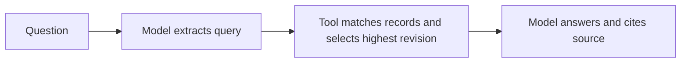

# EvidenceSwitch

[](https://github.com/xMaxos/evidence-switch/actions/workflows/tests.yml)

**Reproducible checks for evidence-sensitive, tool-assisted AI answers.**

Generate fictional record-reading tasks, run a model, and check whether its
answers change correctly when evidence changes or disappears. Python 3.10+,
no runtime dependencies, [MIT license](LICENSE).

[Usage](docs/usage.md) · [Methodology](docs/methodology.md) · [All results](results/README.md) · [Changelog](CHANGELOG.md) · [Contributing](CONTRIBUTING.md)

## Latest: version 0.5.0

The optional `two-stage-latest` strategy fixes the two reproduced Llama revision
errors by having the retrieval tool select the highest numeric revision. The
model still generates the final answer. On a fresh 180-question set per model:

| Model | Prior retrieval | Latest-revision mode | Correct answer pairs |
| --- | ---: | ---: | ---: |
| llama | 179/180 | 180/180 | 89/90 → 90/90 |
| qwen | 180/180 | 180/180 | 90/90 → 90/90 |

[Read the complete test report and raw evidence](results/2026-10-15-latest-revision/).
The two known failures were checked separately, not included in this table.
Both models share the same 180 questions. The results apply to these synthetic
tasks and model versions; they do not establish a general intelligence gain.



The tool implements the matching and ranking rules. This is a combined
model/tool workflow, not an unaided reasoning benchmark or model training.
Older strategies remain available and `direct` is still the CLI default.

## Quick start

From this repository's directory, run the offline demonstration:

```sh
python -m evidenceswitch demo --out demo
```

This uses simulated responders to demonstrate scoring; it is not a real AI test.

With Ollama and a local model already installed:

```sh
python -c "from pathlib import Path; Path('runs').mkdir(exist_ok=True)"
python -m evidenceswitch run-ollama --prompts examples/mini/prompts.jsonl --model llama3.1:8b --strategy two-stage-latest --out runs/latest.jsonl --trace runs/latest-trace.jsonl
python -m evidenceswitch score --cases examples/mini/cases.jsonl --responses runs/latest.jsonl
```

The native runner stays on loopback and never downloads models. Local runs
have no hosted API fee; electricity and hardware use still apply. Hosted
endpoints through the separate `run` command may charge. Output paths are never
overwritten; choose a new name for another run.

## Verify the published evidence

```sh
python -m unittest discover -s tests -v
python scripts/verify_results.py
```

These commands need no model or API key. The verifier checks all published
experiments, including failed development attempts. CI runs on Windows and
Linux with Python 3.10, 3.12 and 3.13.

## Find your way around

| Location | Contents |
| --- | --- |
| [evidenceswitch/](evidenceswitch/) | Generator, scoring, runners and optional workflows |
| [examples/mini/](examples/mini/) | Six inspectable English fixtures |
| [docs/](docs/) | Usage and methodological limits |
| [results/](results/README.md) | Experiment index, reports and unchanged raw evidence |
| [tests/](tests/) | Standard-library software tests |

For generation, all strategy options, scoring rules and CI thresholds, see the
[usage guide](docs/usage.md). For known limits and how deterministic tools affect
the interpretation of scores, see [methodology](docs/methodology.md).
